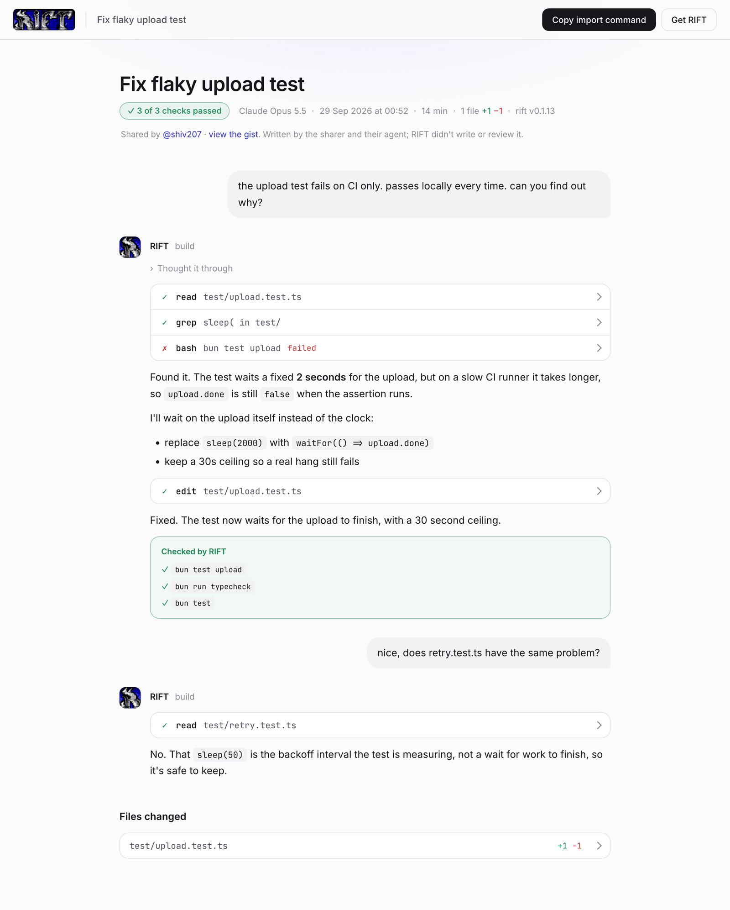

<p align="center">
  
</p>

<p align="center"><b>An open-source AI coding agent for your terminal that runs your tests instead of telling you they passed.</b></p>

<p align="center">
  <a href="https://github.com/Datum-Collective/RIFT-coding-agent/releases/latest"></a>
  <a href="https://github.com/Datum-Collective/RIFT-coding-agent/stargazers"></a>
  <a href="LICENSE"></a>
  
  <a href="https://github.com/anomalyco/opencode"></a>
</p>

<p align="center">
  <a href="#install-rift">Install</a> |
  <a href="#what-rift-does">What it does</a> |
  <a href="#how-rift-compares">Comparison</a> |
  <a href="#share-a-session">Sharing</a> |
  <a href="#configuration">Configuration</a> |
  <a href="#faq">FAQ</a> |
  <a href="#credits">Credits</a>
</p>

---

# RIFT: an open-source AI coding agent for the terminal

RIFT is a free, MIT-licensed AI coding agent. You run `rift` inside a project, describe a change in
plain English, and it reads the code, plans the work, edits the files, and then does the part most
coding agents leave to you: it runs the project's own tests, typechecker and linter and shows you
the real output.

Most AI coding tools end a task by saying it worked. RIFT ends it by showing you, or by saying
plainly that it could not check. It also compares what it said it did with the actual `git diff`
and flags any claim the diff does not back up.

It works with Claude, GPT, Gemini, Llama, Mistral, DeepSeek and local models through one command,
and runs on macOS, Linux and Windows. RIFT is a fork of [OpenCode](https://github.com/anomalyco/opencode),
and most of the code here is theirs (see [Credits](#credits)).

**Use RIFT if you want:**

- an AI pair programmer in the terminal that you can read, audit and change, because it is open source
- a coding agent that proves a change works before you review it
- your choice of model and provider, with no subscription tied to the tool
- a record of what the agent did, with diffs and check results, that you can share as a link

## Install RIFT

<a href="https://yatko.app/Datum-Collective/RIFT-coding-agent">
  
</a>

**macOS, Linux, WSL, Git Bash**

```bash
curl -fsSL https://raw.githubusercontent.com/Datum-Collective/RIFT-coding-agent/main/opencode/install | bash
```

**Windows (PowerShell)**

```powershell
irm https://raw.githubusercontent.com/Datum-Collective/RIFT-coding-agent/main/opencode/install.ps1 | iex
```

If a folder such as `~/.local/bin` or `/opt/homebrew/bin` is already on your `PATH`, the installer
links `rift` there and it works straight away. If not, it adds itself to your shell config and
tells you the one command to run (`source ~/.zshrc`) or to open a new terminal. Then point it at a
project:

```bash
cd your-project
rift
```

There is nothing else to install: no Node, no Python, no build step. The installer downloads one
self-contained binary (31 to 47 MB depending on your platform) from
[Releases](https://github.com/Datum-Collective/RIFT-coding-agent/releases). `opencode` starts it
too, so either command works.

<details>
<summary><b>Pin a version, change the install directory, uninstall</b></summary>

```bash
# a specific release
curl -fsSL https://raw.githubusercontent.com/Datum-Collective/RIFT-coding-agent/main/opencode/install | bash -s -- --version 0.2.0

# somewhere other than ~/.rift/bin
RIFT_INSTALL_DIR=/usr/local/bin curl -fsSL .../install | bash

# leave shell config files alone
curl -fsSL .../install | bash -s -- --no-modify-path
```

```powershell
# irm | iex takes no arguments, so pin a version like this
& ([scriptblock]::Create((irm https://raw.githubusercontent.com/Datum-Collective/RIFT-coding-agent/main/opencode/install.ps1))) -Version 0.2.0
```

Update with `rift upgrade`, remove with `rift uninstall`.

**macOS:** a binary downloaded through a browser is quarantined by Gatekeeper, because these builds
are not notarized. Clear it with `xattr -dr com.apple.quarantine ~/.rift/bin/rift`. The `curl`
command above avoids the problem.

</details>

## What RIFT does

Everything in this section is what RIFT adds on top of OpenCode.

### It verifies its own work

When the agent finishes editing, RIFT runs the checks your project already has (`test`,
`typecheck`, `lint`, `go test`, `cargo check`, `pytest`) and puts the results in front of you:

```
VERIFICATION ─────────────────────────────────────────
  ✓ bun run typecheck                              1.2s
  ✗ bun test                                     failed
  ○ bun run lint                      permission denied
  ⚠ summary does not match the diff (1)
```

A check that could not run says so. It is never counted as a pass.

### It checks its own summary against the diff

A second model reads what the agent claimed and compares it with the changes that were made:

```
⚠ Summary does not match the diff (1):
- Claimed: added exponential backoff
  Actually: the diff only adds a fixed 200ms delay
```

### It can open the page and look

For UI work, RIFT drives a real browser. It can navigate, click, type and take screenshots, and it
reports the console errors a screenshot never shows. A page that renders perfectly while throwing
on every render gets caught. A whole check (open, fill in a form, click, read the result) runs in
one call.

### The task is the interface, not the chat log

The screen shows the state of the work instead of an endless transcript:

```
TASK ─────────────────────────────────────────────────
  Add retry logic to the API client
  ● executing · opus-5 → haiku-4.5 · 4 files +82 −11

PLAN ─────────────────────────────────────────────────
  ✓ 1. Add the retry helper                 src/retry.ts
  ● 2. Wire it into the client             src/client.ts
  ○ 3. Cover it with tests            test/retry.test.ts

EXECUTION ────────────────────────────────────────────
  ✓ Analyzing code                                 2.1s
  ✓ Editing 4 files                                8.4s
  ● Running tests
```

Dozens of tool calls collapse into the few states worth reading, and the full transcript is one
keystroke away (`ctrl+l`). The sidebar keeps an engineering graph of what is being built, with the
checks RIFT ran under each piece:

```
Engineering graph
└── ● Product · build
    ├── ● Authentication · build
    │   ├── ✓ Database · build
    │   ├── ○ API · build
    │   │   waiting on: Frontend
    │   └── ○ Frontend · build
    └── ● Tools · build
```

### It remembers the task after compaction

Long sessions get compacted, and a model-written summary can drop the goal, a decision, or which
files were touched. RIFT does not rely on the summary alone. It keeps the engineering context of
each session in `.rift/tasks/<session>/`, refreshed after every turn:

```
.rift/tasks/<session>/
├── state.json            goal, plan, decisions, touched files, git, verification
├── plan.md
├── decisions.md
├── touched-files.json
├── verification.json
└── checkpoints/          the handoff written at each compaction
```

When a session compacts, RIFT writes a checkpoint first and appends a handoff to the summary. The
handoff is built from what RIFT recorded (your requests, the plan, the engineering graph,
`git status`, the last check results), not written by a model, so the agent resumes with the same
goal, plan and decisions it had before. The folder is git-ignored. Set `"task_state": false` to
turn it off.

### Vibe Mode

A strong model plans and reviews each step while a cheaper one does the work, so you get good
decisions without paying frontier prices for every edit. A step that cannot be finished within a
fixed number of turns counts as failed and goes back to the planner instead of looping.

### MCP, the way other clients do it

RIFT reads your existing `.mcp.json`, plus `~/.rift/mcp.json` and the `mcp` key in `rift.json`, in
the usual `mcpServers` shape with `${VAR}` and `${VAR:-default}`. A server from a project's
`.mcp.json` waits for your approval before it runs (once, always or deny), remembered per project.
Servers start on first use, and with many tools RIFT sends only their names plus one search tool,
which keeps requests small. Manage them with `rift mcp add`, `add-json`, `get`, `list` and
`remove`, or from the `/mcp` panel.

### Make videos with Remotion

Type `/remotion` and a sentence, in any project:

```
/remotion 30-second vertical launch video for this project, for developers
```

RIFT builds videos with [Remotion](https://www.remotion.dev), using Remotion's official Agent
Skills. It writes a storyboard first, builds the composition, checks a still from every scene
before rendering, and confirms the MP4's resolution, length and frame rate before calling it done.

- `rift remotion setup` installs the skills in the project, or for your user with `-g`. RIFT also
  loads skills from Claude Code plugins you have installed.
- `rift remotion new <name>` creates a Remotion project and `rift remotion studio` opens Remotion
  Studio for hand-tuning.

Rendering needs Node 20 or newer. No paid services are involved.

### Share a session

Type `/share` and a link is on your clipboard in about two seconds. It opens the session in the
RIFT viewer: your prompts, RIFT's steps, the diffs and the checks RIFT ran, with a pass or fail
count up front.



- **It is yours.** The session is saved as a secret Gist on your own GitHub account, through
  `gh auth login` or `GITHUB_TOKEN`. `/unshare` deletes it.
- **Only the link opens it.** The Gist id sits after the `#` in the link, which browsers never send
  to a server, and secret Gists are unlisted. The viewer is kept out of search engines.
- **Secrets stay on your machine.** Before upload RIFT removes the API keys, tokens, private keys,
  passwords, home folder path and screenshots it recognises. Read what you share all the same.
- **It works both ways.** `rift import <link>` brings a shared session into your own RIFT, and
  `rift pr 42` opens a pull request with the session linked in its description.

### Mission Control

Every session on one board, ordered so whatever needs you is on top. Open it with `<leader>o`.

## How RIFT compares

**RIFT and OpenCode.** RIFT is built on OpenCode, so the agent loop, providers, tools, LSP and MCP
support, permissions and config come from them. If you like OpenCode, RIFT will feel familiar and
your `opencode.json`, auth and sessions keep working. RIFT changes the interface (task view,
sidebar, Mission Control) and adds verification, the summary-versus-diff check, browser checks,
session memory across compaction, sharing and Remotion video. The releases are terminal-only: the
web UI and desktop app were dropped from the binary in v0.2.0.

**RIFT and Claude Code, Cursor or GitHub Copilot.** Those are closed-source products tied to their
own accounts. RIFT is MIT-licensed and works with whichever model provider you choose, including
free models and local ones, so you can read exactly what it runs on your machine. Its focus is the
step after generation: proving the change works by running your project's checks.

## Usage

```bash
rift                              # start in the current directory
rift /path/to/project             # start somewhere else
rift run "fix the failing test"   # non-interactive, for scripts and CI
rift --continue                   # resume the last session
rift import <share-link>          # bring a shared session into this project
rift mcp add                      # connect an MCP server
rift remotion setup               # install Remotion's skills for /remotion
```

In a session, `/share` copies a link, `/unshare` takes it down, `/mcp` manages MCP servers and
`/remotion` makes a video.

| Key         | Action                                        |
| ----------- | --------------------------------------------- |
| `ctrl+l`    | Switch between the task view and the full log |
| `<leader>o` | Open Mission Control                          |
| `<leader>d` | Review the diff                               |
| `<leader>b` | Show or hide the sidebar                      |
| `ctrl+p`    | Command palette                               |
| `tab`       | Switch agent                                  |
| `?`         | Show every shortcut                           |

The leader key is `ctrl+x`.

## Agents

RIFT inherits OpenCode's agents, which you switch between with `Tab`:

- **build**: full-access agent for development work
- **plan**: read-only agent for analysis and exploration
- **vibe**: planner and executor models working together, with a review gate between steps

A **general** subagent handles complex searches and multistep tasks. Invoke it with `@general`.

## Configuration

Config lives in `rift.json` in your project, or `~/.config/rift/rift.json` globally.

```json
{
  "$schema": "https://opencode.ai/config.json",
  "model": "anthropic/claude-sonnet-5",
  "verify": true,
  "verify_browser_url": "http://localhost:3000",
  "plannerModel": "anthropic/claude-opus-5",
  "executorModel": "anthropic/claude-haiku-4-5-20251001"
}
```

Set `"share": "disabled"` to turn sharing off for a project, or `RIFT_DISABLE_SHARE=1` to turn it
off everywhere.

Coming from OpenCode? Your existing `opencode.json`, auth and sessions keep working. RIFT reads
both names and leaves your old directory where it is.

The full reference is the config schema in
[opencode/packages/core/src/v1/config/config.ts](opencode/packages/core/src/v1/config/config.ts).

## FAQ

### What is RIFT?

RIFT is an open-source AI coding agent that runs in your terminal. You describe a change, it edits
your code, and then it runs your project's tests, typechecker and linter to check the result. It is
a fork of OpenCode, released under the MIT license.

### Is RIFT free?

Yes. RIFT is MIT licensed and the binaries are free on GitHub Releases. You bring your own model
API key, or use one of the free models that come with it. Model usage is billed by whichever
provider you pick, never by RIFT.

### How is RIFT different from OpenCode?

It is built on OpenCode and adds a verification layer (tests, typecheck and lint run after every
change, with a check of the agent's summary against the diff), a task-focused interface, browser
checks for UI work, session memory that survives compaction, shareable sessions and Remotion video.
See [How RIFT compares](#how-rift-compares).

### How is RIFT different from Claude Code, Cursor or Copilot?

Those are closed-source products tied to their own accounts. RIFT is open source and works with the
model provider you choose. It concentrates on proving that a change works by running your own
checks and showing the output, and it is terminal-first, so you can read what it runs.

### Which AI models does RIFT support?

Anthropic Claude, OpenAI GPT, Google Gemini, Meta Llama, Mistral, DeepSeek, local models through
Ollama, and many more. Set one globally, per project, or per agent.

### Can I run RIFT with local models?

Yes. Point RIFT at a local model server such as Ollama in `rift.json` and nothing leaves your
machine except what that server does.

### Does RIFT work on Windows?

Yes, natively through the PowerShell installer, and through WSL or Git Bash. macOS (Apple silicon
and Intel) and Linux (x64 and arm64, glibc and musl) are supported too.

### Does my code get sent anywhere?

Only to the model provider you configure, as with any AI coding tool. RIFT has no server of its
own. Shell commands, edits and network access go through a permission system you control.

A session leaves your machine only when you `/share` it, and then it goes to a secret Gist on your
own GitHub account, with recognisable secrets and screenshots removed first.

### Who can see a shared session?

Anyone you give the link to, and no one else. It is not listed or indexed anywhere, and
`rift github run` never posts one into a PR comment unless you set `SHARE=true`. `/unshare` deletes
the Gist and the link stops working.

### Can RIFT use MCP servers?

Yes. It reads `.mcp.json` the way other MCP clients do, asks before running a project's servers, and
loads tool details only when the agent needs them.

### Does RIFT have a desktop app or web UI?

The releases are terminal-only. v0.2.0 dropped OpenCode's web UI and desktop app from the binary so
it could be smaller and start faster. The repository still contains a rebranded copy of the desktop
app's source, but it is not built into releases.

## Credits

**RIFT is a fork of [OpenCode](https://github.com/anomalyco/opencode) by
[Anomaly](https://github.com/anomalyco), and the overwhelming majority of this codebase is their
work.** The agent loop, provider layer, tool system, LSP and MCP integration, permissions, config
system and the TUI foundation are all OpenCode's. RIFT rebuilds the interface around tasks and adds
the verification layer, sharing and video described above.

OpenCode is MIT licensed, and so is RIFT. If you like what is here, a great deal of the credit
belongs upstream. [Give them a star](https://github.com/anomalyco/opencode).

**RIFT is not affiliated with, endorsed by, or supported by the OpenCode team.** Please send issues
with RIFT to [this repository](https://github.com/Datum-Collective/RIFT-coding-agent/issues), not to
them.

## Contributing

Issues and pull requests are welcome. Read [docs/branching.md](docs/branching.md) for which branch
to target and [opencode/AGENTS.md](opencode/AGENTS.md) for the code style. Pull requests to `main`
have to pass the `typecheck` check.

## Building from source

You do not need this to use RIFT, because the installer downloads a prebuilt binary.

```bash
git clone https://github.com/Datum-Collective/RIFT-coding-agent.git
cd RIFT-coding-agent/opencode
bun install          # requires bun 1.3.14
bun run dev
```

Cut a release by pushing a tag (`git tag v0.1.0 && git push origin v0.1.0`) and the
[release workflow](.github/workflows/release.yml) builds all twelve platform targets.

## License

MIT, see [LICENSE](LICENSE). Copyright for the inherited code remains with the OpenCode authors.
